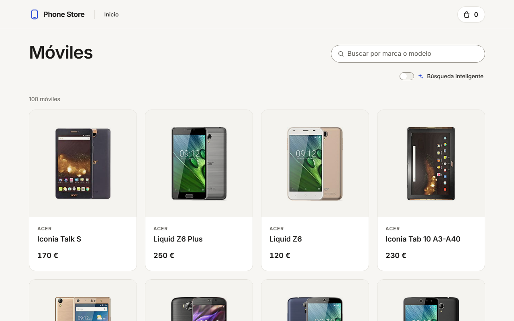
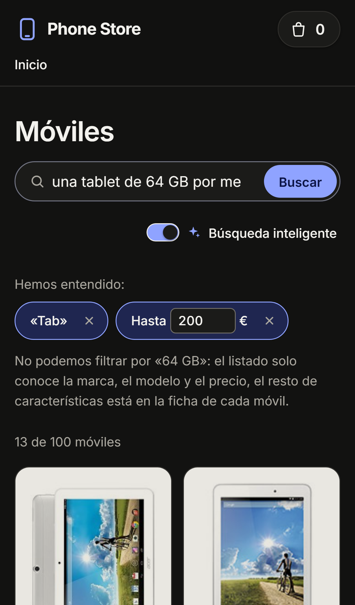
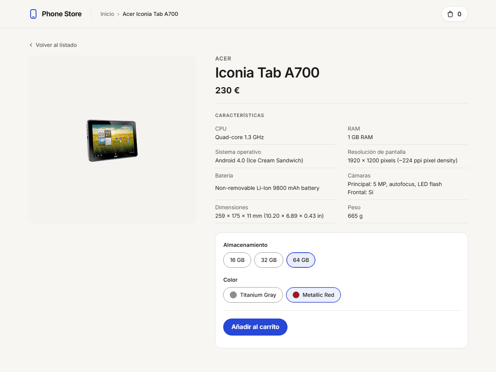
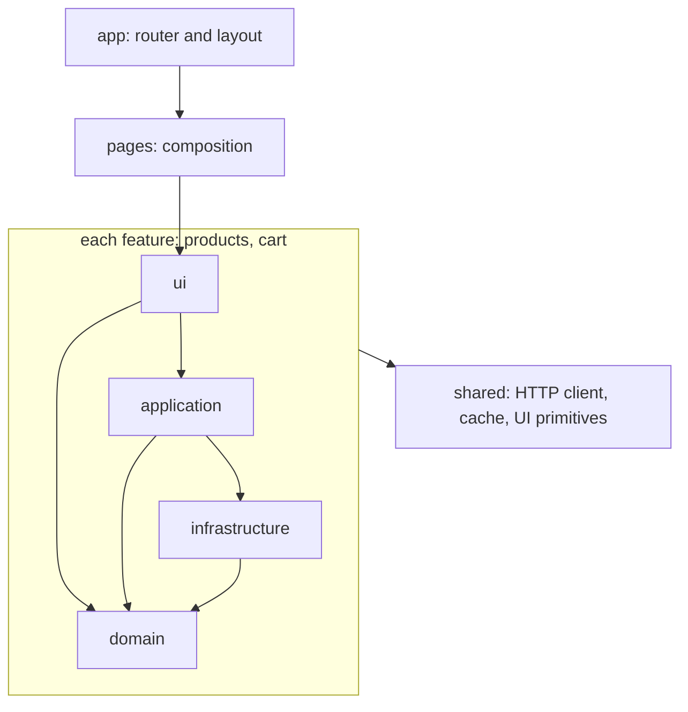
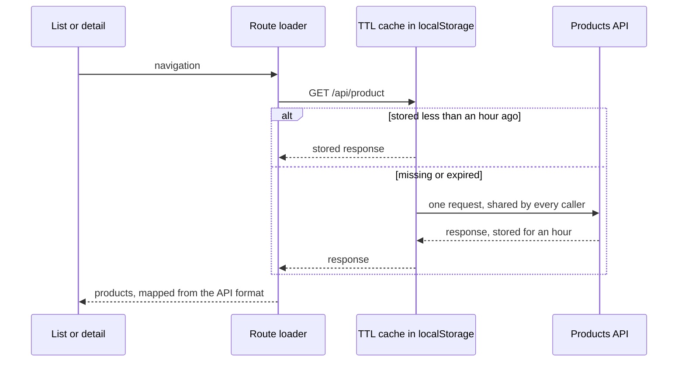
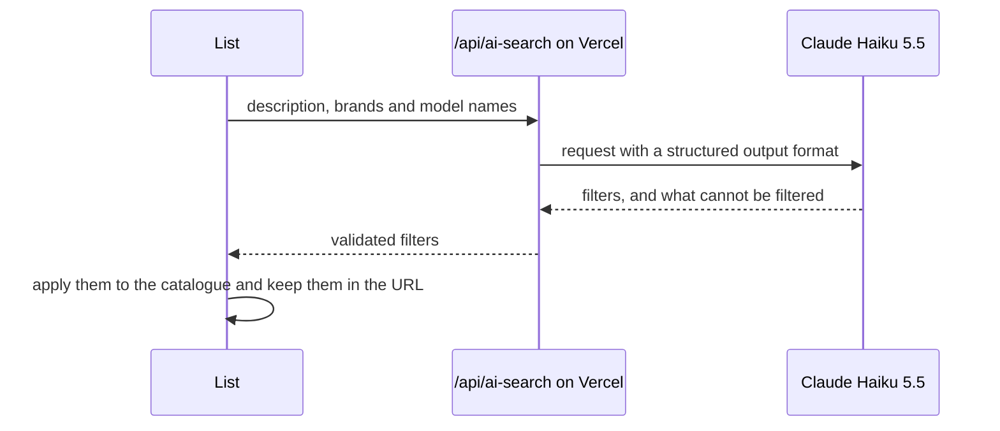

# Phone Store

[](https://github.com/adriansanluis2000/phone-store/actions/workflows/ci.yml)

Solution to a front-end technical test: a single-page application in React to browse and buy mobile phones, built on top of an existing REST API.

**Live demo:** <https://phone-store-adrian.vercel.app/>

> **Status:** complete. Release `v1.0.0` meets [every requirement of the statement](#requirements), is tested end to end and runs in production; `v1.1.0` adds a [smart search](#smart-search) powered by Claude (see the [milestones](#milestones)).

<p align="center">
  
  
</p>
<p align="center">
  
</p>

## What it does

The statement asks for two views and a shared header:

- **Product list.** Shows every product the API returns, at most four per row and adapted to the screen size, with a search box that filters by brand and model on every keystroke. Selecting a product opens its detail.
- **Product detail.** Two columns: the product image on one side, and its description and actions on the other. The actions let the user choose storage and colour, preselected when there is only one option, and add the product to the cart. A link leads back to the list.
- **Header.** The app title links to the list, breadcrumbs show where the user is, and the number of items in the cart is shown on the right in every view, persisted across reloads.

The search term is kept in the URL, as `?q=`, so it survives a visit to a product and a filtered list can be shared ([ADR 0006](docs/adr/0006-search-in-the-url.md)). API responses are cached in the browser for one hour and fetched again once they expire.

### Smart search

Beyond the statement, the list can read a description such as «un Acer por menos de 200 € ordenado por precio». A serverless function asks Claude Haiku 5.5 to turn it into filters (brands, words of the model name, a price range and an order), which the list applies to the catalogue it already has and shows as chips that the user can remove or adjust. What it cannot filter, such as a colour or a capacity, which only the detail of each product knows, it says instead of guessing. The filters are kept in the URL like the search term. The text search of the statement stays the default, and the list goes back to it whenever the smart search is off or fails ([ADR 0011](docs/adr/0011-natural-language-search.md)).

## Getting started

Requires Node.js 24, the version in [`.nvmrc`](.nvmrc), and npm.

```bash
npm ci
npm start
```

The app runs at <http://localhost:5173>.

| Script                  | What it does                                                                |
| ----------------------- | --------------------------------------------------------------------------- |
| `npm start`             | Development server with hot reload                                          |
| `npm run build`         | Type-checks and builds for production into `dist/`                          |
| `npm run preview`       | Serves the production build locally                                         |
| `npm test`              | Runs the unit and component tests once                                      |
| `npm run test:watch`    | Runs the tests in watch mode                                                |
| `npm run test:coverage` | Runs the tests once and checks the coverage thresholds                      |
| `npm run test:e2e`      | Runs the end-to-end tests against the production build, with the API mocked |
| `npm run test:smoke`    | Runs a smoke test against the real API, which can take a minute to wake up  |
| `npm run lint`          | Checks the code with ESLint and the formatting with Prettier                |
| `npm run typecheck`     | Type-checks the project                                                     |
| `npm run format`        | Formats the code with Prettier                                              |

To try the smart search locally, copy [`.env.example`](.env.example) to `.env.local`, which git ignores, and set `ANTHROPIC_API_KEY`; `npm start` also serves the function. To deploy it, set `ANTHROPIC_API_KEY` and `VITE_AI_SEARCH_ENABLED=true` in the environment variables of the Vercel project, and set a spending limit for the key in the Anthropic Console: the function has no rate limit of its own.

The API runs on a free plan that sleeps when idle, so the first request after a quiet period can take a minute or more. After three seconds of waiting, the app tells the user that the server is waking up.

## Stack

| Area       | Choice                                                                                   |
| ---------- | ---------------------------------------------------------------------------------------- |
| Base       | Vite, React 19 and TypeScript in strict mode                                             |
| Routing    | React Router in data mode (loaders, error boundaries, route handles for the breadcrumbs) |
| Styles     | CSS Modules and design tokens as custom properties, no component library                 |
| Data       | Own HTTP client and TTL cache on top of `fetch` and `localStorage`                       |
| Tests      | Vitest, Testing Library and MSW; Playwright and axe end to end                           |
| Quality    | ESLint, Prettier and the TypeScript compiler, run by GitHub Actions on every push        |
| Deployment | Vercel, with a strict Content Security Policy                                            |
| AI         | Claude Haiku 5.5 through the Anthropic SDK, with structured output, in a Vercel Function |

The reasons behind each choice are recorded as [architecture decision records](docs/adr/).

## Architecture

The code is split by feature and, within each feature, by layer ([ADR 0002](docs/adr/0002-layered-feature-architecture.md)):

```text
api/                      Vercel Functions, one entry point per file
server/                   their logic, such as the AI search
src/
├── app/                  router, root layout and global styles
├── pages/                one component per route, composition only
├── features/
│   ├── products/
│   │   ├── domain/          types and pure functions, no React
│   │   ├── infrastructure/  API client and mappers from the API format
│   │   ├── application/     loaders and hooks used by the UI
│   │   └── ui/              components
│   └── cart/             same layers
└── shared/               HTTP client, cache, UI primitives and helpers
```

Dependencies point inwards, from `app` to `shared` and from `ui` to `domain`, and ESLint fails on any import in the opposite direction. Features never import each other: pages compose them ([ADR 0008](docs/adr/0008-features-do-not-import-each-other.md)).



Route loaders start the requests and the pages render at once, waiting only where they need the data ([ADR 0005](docs/adr/0005-route-data-with-suspense.md)). Every response of the API goes through the cache as it arrives, and is mapped to the domain on every read ([ADR 0004](docs/adr/0004-client-cache.md)):



The smart search adds a function on the same domain, so the Claude API key never reaches the browser ([ADR 0011](docs/adr/0011-natural-language-search.md)):



## Decisions and trade-offs

- **Own data layer instead of a data-fetching library.** The statement asks for a client cache, so the HTTP client and the cache are written and tested here, at the cost of more code to maintain than with TanStack Query ([ADR 0003](docs/adr/0003-http-client.md), [ADR 0004](docs/adr/0004-client-cache.md)).
- **Pages that render before their data.** The API can take a minute to wake up, so the header and the page heading show at once and only the data waits ([ADR 0005](docs/adr/0005-route-data-with-suspense.md)). Going back to the list renders it whole from the cache and returns to where the user left it ([ADR 0012](docs/adr/0012-return-to-the-list-where-the-user-left-it.md)).
- **The search in the URL**, so it survives a visit to a product and can be shared, replacing the history entry instead of adding one per keystroke ([ADR 0006](docs/adr/0006-search-in-the-url.md)).
- **The cart count kept in the browser.** The API always answers a count of one, so the app adds them up, persists the total and keeps tabs in step ([ADR 0007](docs/adr/0007-cart-count-in-the-browser.md)).
- **End-to-end tests against saved responses.** Fast and stable in CI; a change in the real API is caught by the smoke test, run on demand ([ADR 0009](docs/adr/0009-end-to-end-tests.md)).
- **A strict Content Security Policy**, tested on every push because the preview server sends the same headers as production ([ADR 0010](docs/adr/0010-deployment-and-security-headers.md)).
- **A smart search that says what it cannot do.** Structured output keeps the answer applicable, and the list states what it cannot filter instead of guessing. It has no rate limit of its own: the spending limit of the key caps the cost ([ADR 0011](docs/adr/0011-natural-language-search.md)).

## API notes

The API was explored with real requests before relying on it; the details are in the [API notes](docs/api-notes.md).

- **Misspelt and irregular fields**, such as `secondaryCmera`, `dimentions`, cameras as a string or a list, empty prices, weights without a unit, and a resolution and a screen size swapped. The mappers absorb them, so they never reach the UI.
- **The cart always answers a count of one**, since its session cookie never travels with these requests, so the count is added up in the browser.
- **An unknown product answers 500**, like a server failure, so both show the same error with a way to retry.
- **The server sleeps when idle** and takes a minute or more to wake up. After three seconds the app says so.

## Requirements

Every requirement of the statement, where it is met and how it is checked. Unit and component tests are run by `npm test`, end-to-end tests by `npm run test:e2e`, and CI runs both on every push.

| ID  | Requirement                                                                                             | Where                                                                                                                                                                                         | Checked by                                                                                                                                                                                       |
| --- | ------------------------------------------------------------------------------------------------------- | --------------------------------------------------------------------------------------------------------------------------------------------------------------------------------------------- | ------------------------------------------------------------------------------------------------------------------------------------------------------------------------------------------------ |
| R1  | React, written in TypeScript                                                                            | Whole app ([ADR 0001](docs/adr/0001-technology-stack.md))                                                                                                                                     | Type check and build                                                                                                                                                                             |
| R2  | Single-page application with client routing, no MPA or SSR                                              | [`routes.tsx`](src/app/routes.tsx), React Router in data mode                                                                                                                                 | [`routes.test.tsx`](src/app/routes.test.tsx)                                                                                                                                                     |
| R3  | `start`, `build`, `test` and `lint` scripts                                                             | [`package.json`](package.json)                                                                                                                                                                | CI                                                                                                                                                                                               |
| R4  | Public repository grown by milestones                                                                   | This repository, tags `v0.1.0`, `v0.2.0`, `v1.0.0`, `v1.1.0` and `v1.1.1`                                                                                                                     | Git history                                                                                                                                                                                      |
| R5  | README in the first commit, with how to run it                                                          | This file, since `a3c33e0`                                                                                                                                                                    | Git history                                                                                                                                                                                      |
| R6  | The list shows every product of the API                                                                 | [`ProductListPage`](src/pages/ProductListPage.tsx)                                                                                                                                            | [`ProductListPage.test.tsx`](src/pages/ProductListPage.test.tsx)                                                                                                                                 |
| R7  | Real-time filter by brand and model                                                                     | [`filterProducts`](src/features/products/domain/filterProducts.ts), [`SearchBar`](src/features/products/ui/SearchBar.tsx)                                                                     | [`filterProducts.test.ts`](src/features/products/domain/filterProducts.test.ts), [`ProductListPage.test.tsx`](src/pages/ProductListPage.test.tsx)                                                |
| R8  | Selecting a product opens its detail                                                                    | [`ProductCard`](src/features/products/ui/ProductCard.tsx)                                                                                                                                     | [`routes.test.tsx`](src/app/routes.test.tsx), [`shop.spec.ts`](e2e/shop.spec.ts)                                                                                                                 |
| R9  | At most four products per row, adapted to the screen                                                    | [`ProductGrid.module.css`](src/features/products/ui/ProductGrid.module.css)                                                                                                                   | [`shop.spec.ts`](e2e/shop.spec.ts), which counts the columns at 360, 768, 1024 and 1440 px                                                                                                       |
| R10 | Detail in two columns: picture, then description and actions                                            | [`ProductDetailView`](src/features/products/ui/ProductDetailView.tsx)                                                                                                                         | Manual check at 360, 768, 1024 and 1440 px                                                                                                                                                       |
| R11 | Link back to the list                                                                                   | [`BackToListLink`](src/features/products/ui/BackToListLink.tsx), keeping the search                                                                                                           | [`ProductDetailPage.test.tsx`](src/pages/ProductDetailPage.test.tsx)                                                                                                                             |
| R12 | The app title links to the list                                                                         | [`Header`](src/shared/ui/Header.tsx)                                                                                                                                                          | [`RootLayout.test.tsx`](src/app/RootLayout.test.tsx)                                                                                                                                             |
| R13 | Breadcrumbs with the current page and links                                                             | [`Breadcrumbs`](src/shared/ui/Breadcrumbs.tsx)                                                                                                                                                | [`RootLayout.test.tsx`](src/app/RootLayout.test.tsx), [`ProductDetailPage.test.tsx`](src/pages/ProductDetailPage.test.tsx)                                                                       |
| R14 | Cart count on the right of the header                                                                   | [`CartBadge`](src/features/cart/ui/CartBadge.tsx)                                                                                                                                             | [`RootLayout.test.tsx`](src/app/RootLayout.test.tsx)                                                                                                                                             |
| R15 | Each item shows picture, brand, model and price                                                         | [`ProductCard`](src/features/products/ui/ProductCard.tsx)                                                                                                                                     | [`ProductCard.test.tsx`](src/features/products/ui/ProductCard.test.tsx)                                                                                                                          |
| R16 | Description with brand, model, price, CPU, RAM, OS, resolution, battery, cameras, dimensions and weight | [`ProductDetailView`](src/features/products/ui/ProductDetailView.tsx) header for brand, model and price; [`ProductDescription`](src/features/products/ui/ProductDescription.tsx) for the rest | [`ProductDetailPage.test.tsx`](src/pages/ProductDetailPage.test.tsx)                                                                                                                             |
| R17 | Storage and colour selectors, preselected when there is a single option                                 | [`ProductActions`](src/features/products/ui/ProductActions.tsx), [`OptionSelector`](src/features/products/ui/OptionSelector.tsx)                                                              | [`ProductDetailPage.test.tsx`](src/pages/ProductDetailPage.test.tsx)                                                                                                                             |
| R18 | Adding sends `{ id, colorCode, storageCode }` to `POST /api/cart`                                       | [`addItemToCart`](src/features/cart/application/addItemToCart.ts)                                                                                                                             | [`ProductDetailPage.test.tsx`](src/pages/ProductDetailPage.test.tsx), [`cartApi.test.ts`](src/features/cart/infrastructure/cartApi.test.ts)                                                      |
| R19 | The returned count is shown in every view and persisted                                                 | [`cartStore`](src/features/cart/application/cartStore.ts) ([ADR 0007](docs/adr/0007-cart-count-in-the-browser.md))                                                                            | [`ProductDetailPage.test.tsx`](src/pages/ProductDetailPage.test.tsx), [`cartStore.test.ts`](src/features/cart/application/cartStore.test.ts), [`shop.spec.ts`](e2e/shop.spec.ts) across a reload |
| R20 | API responses cached in the browser for one hour, then revalidated                                      | [`TtlCache`](src/shared/cache/ttlCache.ts) ([ADR 0004](docs/adr/0004-client-cache.md))                                                                                                        | [`ttlCache.test.ts`](src/shared/cache/ttlCache.test.ts), [`productApi.test.ts`](src/features/products/infrastructure/productApi.test.ts)                                                         |
| R21 | The structure of the wireframes                                                                         | Search above the grid on the right; picture left, description and actions right                                                                                                               | Manual check at 360, 768, 1024 and 1440 px                                                                                                                                                       |

## Quality

- **Unit and component tests.** 114 tests with Vitest, Testing Library and MSW, which serves the real API responses saved in [`src/test/fixtures`](src/test/fixtures). The AI search function is tested with the SDK mocked, so no test calls the model. CI fails below 90% of lines and 85% of branches in the domain, application and shared layers; the whole app is at 96% and 92%.
- **End-to-end tests.** Playwright runs the whole journey on the production build, on a desktop and an emulated phone, and the smart search with its function mocked, and fails on any error in the browser console ([ADR 0009](docs/adr/0009-end-to-end-tests.md)).
- **Accessibility.** axe finds no WCAG 2.2 AA violation in either view, in the light or the dark theme. Everything works with the keyboard alone: a skip link, visible focus, focus on the page heading after every navigation, and the options as radio groups.
- **Performance.** The detail page is a chunk of its own, downloaded in the background while the list is shown, and resting the pointer on a card fetches that product before the click. Pictures keep their space while they load, so nothing on the page moves.
- **Security.** A Content Security Policy without inline scripts or styles, and the usual security headers, also served by `npm run preview` so the end-to-end tests run under them ([ADR 0010](docs/adr/0010-deployment-and-security-headers.md)).

Lighthouse 13 on the deployed app:

| Page   | Device  | Performance | Accessibility | Best practices | SEO |
| ------ | ------- | ----------- | ------------- | -------------- | --- |
| List   | Mobile  | 96          | 100           | 96             | 100 |
| List   | Desktop | 100         | 100           | 96             | 100 |
| Detail | Mobile  | 95          | 100           | 96             | 100 |
| Detail | Desktop | 100         | 100           | 96             | 100 |

The points lost in best practices come from the API, which sets a session cookie without the `SameSite` attribute.

## Documentation

| Document                                                   | What it holds                                                   |
| ---------------------------------------------------------- | --------------------------------------------------------------- |
| [Architecture decision records](docs/adr/)                 | Every relevant decision, with its alternatives and consequences |
| [API notes](docs/api-notes.md)                             | What the real API returns, and how the app deals with it        |
| [AI-assisted development](docs/ai-assisted-development.md) | How the solution was built with an AI coding agent              |
| [Next steps](docs/next-steps.md)                           | What was left out on purpose, and why                           |

## Milestones

| Phase | Goal                                                                  | Release  | Status |
| ----- | --------------------------------------------------------------------- | -------- | ------ |
| 0     | Project setup, CI and API exploration                                 |          | Done   |
| 1     | Data layer: HTTP client, cache and API clients                        |          | Done   |
| 2     | App skeleton: routing, layout and header                              |          | Done   |
| 3     | Product list page                                                     | `v0.1.0` | Done   |
| 4     | Product detail page and cart, with every requirement of the statement | `v0.2.0` | Done   |
| 5     | Production: end-to-end tests, performance and deployment              | `v1.0.0` | Done   |
| 6     | Extra: natural language search powered by Claude                      | `v1.1.0` | Done   |
| 7     | Final review and documentation                                        | `v1.1.1` | Done   |
